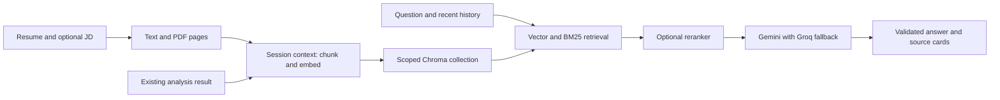

# RAG chat connection: implemented

The separate RAG engine is adapted from https://github.com/shahmit107/RAG.git,
under `backend/pipeline`. Adapted copies are in `rag_engine/`, with provenance
recorded in `rag_engine/README.md`. The integration runs inside the analyser's backend.

## Connection

| File | Responsibility |
| --- | --- |
| `rag_engine/` | Chunking, Gemini embeddings, hybrid retrieval, optional CrossEncoder, grounded generation and provider fallback adapted from your RAG |
| `chat_service.py` | Immutable context snapshots, embedding reuse, session/context filters, citation validation, scoped deletion |
| `chat_schemas.py` | Bounded requests, document pages, conversation history, and typed answers |
| `chat_ui.py` | Document selectors, automatic indexing on first question, chat history, source cards, reset/cleanup |
| `document_parsing.py` | PDF page text, DOCX paragraphs/tables, and UTF-8 TXT |
| `server.py` | Chat endpoints and lazy analysis startup |
| `app.py` | Upload page metadata and the sixth Chat tab |

## API

| Endpoint | Purpose |
| --- | --- |
| `GET /health` | Check backend startup without loading ESCO or analysis resources |
| `POST /chat/documents` | Prepare a resume, optional JD, and optional matching analysis; return context ID and chunk count |
| `POST /chat` | Ask within a prepared session/context, with up to six previous messages |
| `DELETE /chat/sessions/{session_id}` | Delete that session's indexed contexts |
| `DELETE /chat/documents/{document_id}?session_id=...` | Delete that session's contexts that contain the removed document |

`/query` remains available for the analyser's older general RAG prototype. The new
Chat tab uses the scoped `/chat` endpoints.

## Retrieval and evidence

Context IDs hash session, document contents/pages, selected JD, analysis, and embedding
model. Identical requests reuse the snapshot. Unchanged text vectors are reused within
the same session when selecting another JD or adding analysis. New content produces a
new context; older snapshots remain until the document or session is deleted.

Both dense search and BM25 load only the requested session/context. BM25 is rebuilt
from that snapshot, avoiding stale upload caches. Rank fusion preserves chunk IDs,
including identical text in different sources. Short contexts receive full coverage;
longer ones include relevant resume/JD evidence and the existing analysis.

PDF citations retain real page numbers. TXT, DOCX and analysis citations have no invented
pages. The model returns cited chunk IDs; the backend checks them and builds source
cards using stored metadata. The model cannot supply arbitrary source filenames/pages.
Unsupported questions return a consistent insufficient-information answer.

History helps interpret follow-ups but is not factual evidence. The prompt distinguishes
resume facts, JD requirements and computed analysis, and describes unlisted skills as
not evidenced in the resume. It does not compute new match scores.

## Providers and configuration

Gemini embeddings use `RETRIEVAL_DOCUMENT` and `RETRIEVAL_QUERY`. Generation defaults
to `gemini-3.5-flash-lite` with the SDK's `response_json_schema` setting; responses are
also validated locally. A configured Groq key enables the original `openai/gpt-oss-20b`
fallback, whose JSON is validated the same way. Set model names in `.env` as needed.

Reranking is optional (`RAG_RERANK=false` by default), so the initial chat does not
require downloading a neural reranker. Resume/JD indexing and queries use Gemini.

## Practical limits

This is a local application. Random session IDs separate browser conversations but
are not production authentication. A multi-user deployment needs server-derived user
ownership, authorization on every operation, and retention rules. OCR and durable
server-side conversation storage are not included. Gap analysis still requires
the real ESCO dataset; resume/JD chat can start without it.

Primary references: [Chroma filtering](https://docs.trychroma.com/docs/querying-collections/metadata-filtering),
[Gemini embeddings](https://ai.google.dev/gemini-api/docs/embeddings),
[Gemini structured output](https://ai.google.dev/gemini-api/docs/structured-output),
and [Streamlit chat](https://docs.streamlit.io/develop/api-reference/chat/st.chat_message).
